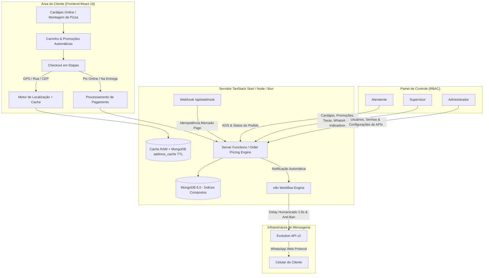
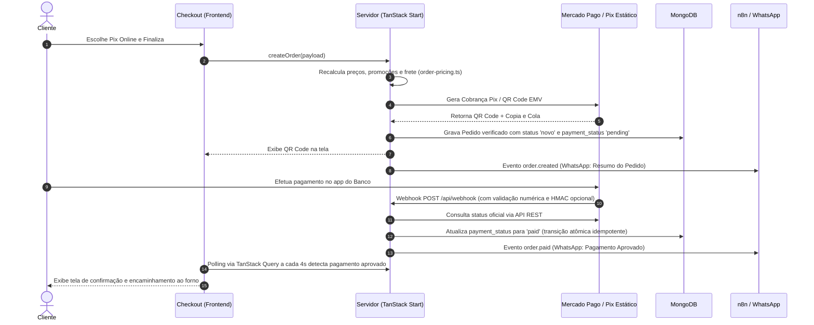

# Relatório Oficial de Documentação Técnica e Funcional do Sistema (Auditoria de Software)

**Projeto:** Plataforma Digital de Vendas, Checkout Inteligente, Automação de WhatsApp e Gestão Operacional — Pizzaria Império  
**Versão Atual da Aplicação:** 2.3.0  
**Data da Auditoria:** 02 de Setembro de 2026  
**Classificação do Documento:** Documentação Técnica Oficial, Fluxos de Dados, Arquitetura, Segurança e Compliance  

---

## 1. Sumário Executivo & Finalidade do Sistema

O sistema **Pizzaria Império** é uma plataforma web full-stack de alto desempenho desenvolvida para automatizar e otimizar toda a esteira operacional de um delivery moderno:
1. **Cardápio Digital Responsivo:** Visualização fluida de produtos, pizzas inteiras e meio a meio (8 fatias), brotos, bebidas, adicionais, massas artesanais de 48h de fermentação, bordas recheadas e promoções automáticas calculadas em tempo real.
2. **Checkout Inteligente com Geocodificação Híbrida:** Resolução de endereços via consulta de CEP no cliente (`ViaCEP → BrasilAPI → AwesomeAPI`) e busca de ruas/GPS em 5 camadas no servidor (ViaCEP, Photon, Nominatim, Catálogo de 99 Bairros no MongoDB e Failover Google Maps).
3. **Mecanismo de Cache de Alto Desempenho (Duplo Nível):** Cache em memória RAM (< 1ms) e cache persistente no MongoDB (`address_cache` com índice TTL de 30 dias) para eliminar custos e consumo desnecessário de APIs externas.
4. **Liquidação Financeira e Conciliação:** Pagamentos instantâneos via Pix (Mercado Pago dinâmico com Webhook idempotente ou Pix estático EMV Banco Central) e pagamento presencial na entrega/retirada/local (Dinheiro com troco ou Cartão de Crédito/Débito na maquininha), com recálculo autoritativo anti-adulteração no servidor (`src/lib/order-pricing.ts`).
5. **Comunicação Automatizada no WhatsApp via n8n & Evolution API:** Notificações em tempo real com simulação de digitação humana (`2800ms`) e proteções ativas contra banimento (*anti-ban*).
6. **Painel Operacional com Controle de Acesso Baseado em Papéis (RBAC):** Gestão de operadores, alteração de senhas com hash `scrypt`, controle de pedidos em tempo real (KDS), gestão de cardápio e promoções, indicadores de vendas e tabelas dinâmicas de frete por bairro.

---

## 2. Arquitetura e Stack Tecnológica

### 2.1. Frontend & Client-Side
* **Framework:** React 19 com TypeScript 5.8.
* **Roteamento & SSR:** TanStack Router v1, TanStack Start v1 (Server Functions tipadas) e TanStack Query v5.
* **Design System & Estilização:** Tailwind CSS v4, Lucide React Icons, Radix UI Primitives.
* **Isolamento de Bundles:** Separação estrita de código de execução do servidor (`*.server.ts` e `*.functions.ts`), garantindo que tokens, chaves de API e conexões com o MongoDB jamais sejam expostos ao bundle do navegador do cliente.

### 2.2. Camada de Dados e Persistência (MongoDB 6.0)
A persistência utiliza MongoDB com índices otimizados para alta concorrência:
* **`orders`:** Armazena os pedidos, itens estruturados (`pizza_id`, `flavor2_id`, `crust_id`, `base_pizza_name`), status de produção (`novo`, `preparando`, `saiu`, `entregue`, `cancelado`), status de liquidação (`pending`, `paid`, `failed`, `refunded`, `on_delivery`), identificadores de gateway e metadados de auditoria.
* **`users`:** Armazena operadores do sistema com e-mail único, hash criptográfico de senha com salt aleatório (`scrypt`) e array de permissões (`roles`).
* **`menu_overrides`:** Sobrescritas dinâmicas de preço, disponibilidade (`available`) e selo (`badge`) sobre o catálogo-base em `src/data/catalog.ts`.
* **`promotions`:** Regras de promoções automáticas (`PERCENTAGE_DISCOUNT`, `FIXED_DISCOUNT`, `BUY_X_GET_Y`) com índice `{ active: 1, created_at: -1 }`.
* **`delivery_settings`:** Tabela com os **99 bairros oficiais de Bragança Paulista - SP**, suas respectivas tarifas de entrega e a taxa padrão (`default_fee`, aceitando `R$ 0,00`).
* **`address_cache`:** Histórico de consultas de ruas e coordenadas GPS com índice TTL automático de 30 dias (`updated_at`).
* **`settings`:** Configurações e chaves de API dinâmicas (Evolution API, n8n webhook, Mercado Pago, Google Maps API key).

### 2.3. Infraestrutura & Isolamento Docker
Toda a infraestrutura roda conteinerizada:
* **`web`:** Aplicação SSR em produção (multi-stage Bun + `vite build`) exposta na porta `3002:8080`.
* **`db` (`pizzaria_db`):** Instância MongoDB 6.0 autenticada via variáveis do `.env`.
* **`evolution_api` (`pizzaria_evolution`):** Instância da Evolution API v2 na porta `8085:8080`.
* **`postgres` (`pizzaria_postgres`):** PostgreSQL 15 para persistência das sessões da Evolution API.
* **`evolution_manager` (`pizzaria_evolution_manager`):** Interface web de gerenciamento da Evolution API na porta `8086:80`.

---

## 3. Módulos Funcionais e Fluxos Detalhados

### 3.1. Motor de Localização Inteligente e Frete em 5 Camadas com Cache

* **CEP no Cliente (`src/hooks/useDeliveryAddress.ts`):** Consulta em cascata `ViaCEP → BrasilAPI → AwesomeAPI` com timeout de 2.5s por camada.
* **Busca de Ruas e GPS no Servidor (`src/lib/location.functions.ts`):**
  * **Camada 0 (Cache Duplo Nível):** Memória RAM (30 dias) e coleção `address_cache` no MongoDB com TTL automático de 30 dias.
  * **Camada 1 (ViaCEP Oficial):** Resolução primária de logradouros de Bragança Paulista.
  * **Camada 2 (Photon Komoot OSM):** Busca tolerante a pequenos erros ortográficos.
  * **Camada 3 (Nominatim OSM):** Geocodificação reversa de GPS e busca estruturada.
  * **Camada 4 (Catálogo dos 99 Bairros no MongoDB `_id: "global"`):** Correspondência direta na base de bairros cadastrados.
  * **Camada 5 (Google Maps Geocoding API - Failover):** Acionada somente quando as camadas anteriores não retornam resultados e `query.length >= 4` (usando chave configurada em `settings` ou `.env`).

---

### 3.2. Liquidação Financeira e Pagamentos

---

### 3.3. Automação de WhatsApp com Políticas Anti-Bloqueio (Anti-Ban)

O fluxo n8n (`PizzariaImperio.json`) aplica proteções de mensageria corporativa:
1. **Simulação de Digitação (`delay: 2800ms`):** Aciona status *"Digitando..."* antes do envio.
2. **Higienização de Número Telefônico:** Normalização para evitar duplicidade de DDI (`55...`).
3. **Desativação de Prévia de Links (`linkPreview: false`):** Reduz análise heurística de spam.
4. **Disparo Reativo por Ciclo de Vida (com `delivery_mode`):**
   * `order.created`: Resumo do pedido e orientações de pagamento.
   * `order.paid`: Confirmação de pagamento (automática via webhook ou manual no painel).
   * `order.status_updated`: Disparado pelo backend nos eventos essenciais `saiu` e `cancelado` (política anti-ban).

---

## 4. Segurança, Criptografia e Matriz de Acessos (RBAC)

### 4.1. Autenticação, Anti-Tampering e Criptografia
* **Hash de Senhas:** Algoritmo **`scrypt`** com salt aleatório de 16 bytes e comparação em tempo constante (`timingSafeEqual`) em `src/lib/hash.ts`.
* **Sessões e Tokens JWT:** Assinatura HMAC-SHA256 (`JWT_SECRET` obrigatório em produção em `src/lib/jwt.ts`) com validação no middleware `requireAuth` (`src/lib/auth-middleware.ts`).
* **Anti-Tampering Financeiro:** `src/lib/order-pricing.ts` valida estritamente catálogo, disponibilidade, regra meio a meio, gatilhos de promoções (`evaluateCartPromotions`) e frete no servidor, ignorando valores adulterados pelo cliente.
* **Proteção contra XSS:** Impressão térmica fallback (`src/lib/thermal-printer.ts`) aplica `escapeHtml` em todos os campos do pedido.
* **Proteção de Administradores:** Bloqueio contra exclusão ou rebaixamento do último administrador ativo (`src/lib/users.functions.ts`).

### 4.2. Matriz de Permissões RBAC (Role-Based Access Control)

| Funcionalidade / Recurso | Atendente | Supervisor | Administrador |
| :--- | :---: | :---: | :---: |
| Visualizar Pedidos em Tempo Real (KDS) & Impressão | ✅ | ✅ | ✅ |
| Alterar Status de Produção e Confirmar Pix Manual | ✅ | ✅ | ✅ |
| Gerenciar Cardápio (Preços, Disponibilidade e Selos) | ❌ | ✅ | ✅ |
| Gerenciar Promoções Automáticas | ❌ | ✅ | ✅ |
| Visualizar Status e Gerar QR Code do WhatsApp | ❌ | ✅ | ✅ |
| Visualizar Indicadores de Faturamento e Vendas | ❌ | ✅ | ✅ |
| Gerenciar Tabela de Taxas de Bairros de Bragança | ❌ | ✅ | ✅ |
| **Cadastrar, Alterar Cargo, Redefinir Senha e Excluir Usuários** | ❌ | ❌ | ✅ |
| **Configurar Tokens de APIs, n8n, Webhooks e Google Maps Key** | ❌ | ❌ | ✅ |

---

## 5. Auditoria de Desempenho e Stress Testing

O script `scripts/stress-test.ts` executa um benchmark direto de validação Zod + inserção concorrente no MongoDB (`orders`) para avaliar a capacidade de escrita da camada de banco de dados em cenários de pico (30 pedidos concorrentes, ~120 inserções/s, latência média de 37ms).

---

## 6. Checklist de Auditoria e Conformidade Técnica

| Item de Auditoria | Status | Evidência Técnica |
| :--- | :---: | :--- |
| **Criptografia de Senhas** | ✅ Conforme | Algoritmo `scrypt` com salt aleatório em `src/lib/hash.ts` |
| **Controle de Acesso RBAC** | ✅ Conforme | Middleware `requireAuth` e checagens em `src/lib/users.functions.ts` e `*.functions.ts` |
| **Anti-Tampering de Pedidos** | ✅ Conforme | Recálculo estrito de itens, promoções e frete em `src/lib/order-pricing.ts` |
| **Idempotência & Validação de Webhook** | ✅ Conforme | Validação numérica, HMAC opcional e transição atômica em `src/routes/api/webhook.ts` |
| **Proteção XSS na Impressão** | ✅ Conforme | Sanitização `escapeHtml` em `src/lib/thermal-printer.ts` |
| **Resiliência e Failover de Localização** | ✅ Conforme | 5 camadas em `src/lib/location.functions.ts` + cache RAM e MongoDB TTL 30 dias |
| **Proteção Anti-Ban WhatsApp** | ✅ Conforme | Delays de 2.8s, `linkPreview: false` e normalização de DDI no n8n |
| **Gestão Dinâmica de Chaves** | ✅ Conforme | Variáveis via `.env` (`.env.example`) e coleção `settings` sem segredos hardcoded |

---

*Documento atualizado e sincronizado com o código-fonte em produção.* 🍕📄
